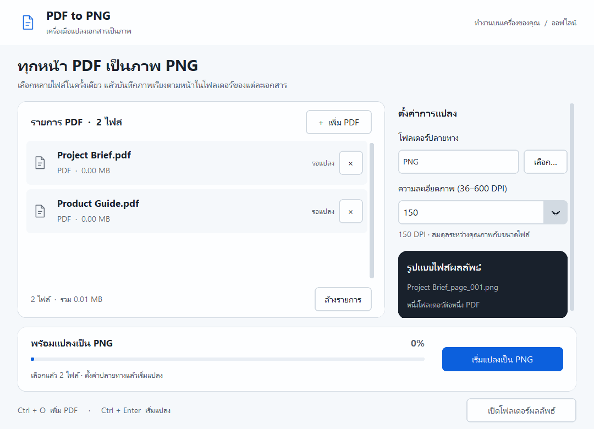
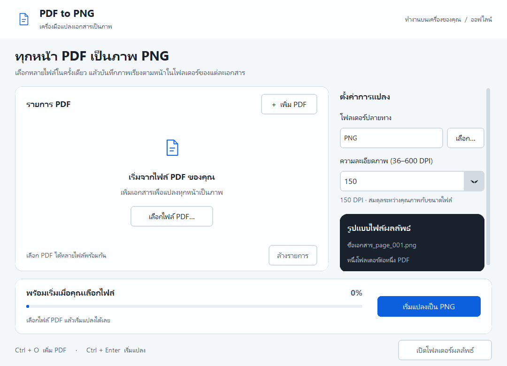

<h1>PDF LoveR</h1>

<strong>แปลงภาพ รวมเอกสาร แยก PDF และเลือกหน้าที่ต้องการ</strong> 
รุ่นพัฒนา 1.4.0 มี 5 เครื่องมือพร้อมใช้ พร้อมตัวเลือกช่วงหน้าและตรวจผลลัพธ์ก่อนบันทึก

Windows 10 / 11 · 64-bit · ใช้งานออฟไลน์ · ไม่ต้องติดตั้ง Python

  <a href="https://github.com/Ntdpz/PDF_LoveR/releases/latest/download/PDF_to_PNG.exe"><strong>ดาวน์โหลดแบบเปิดได้ทันที</strong></a>
  &nbsp; · &nbsp;
  <a href="https://github.com/Ntdpz/PDF_LoveR/releases/latest/download/PDF_to_PNG_Setup_1.0.0.exe">ดาวน์โหลดตัวติดตั้ง</a>
  &nbsp; · &nbsp;
  <a href="https://github.com/Ntdpz/PDF_LoveR/releases/latest">ดูไฟล์ทั้งหมด</a>

## เครื่องมือที่พร้อมใช้ใน 1.4.0

- **[รวม PDF](docs/MERGE.md)** — ลากการ์ดจัดลำดับ พร้อมภาพตัวอย่าง
- **[แยก PDF](docs/SPLIT.md)** — ทุกหน้า, ช่วงหน้า เช่น `1-3,5,8-10` หรือทุก N หน้า; ดูชื่อไฟล์ก่อนบันทึก
- **[แยกหน้าและลบหน้าออก](docs/PAGE_TOOLS.md)** — เลือกหน้าจากภาพตัวอย่าง ตรวจหน้าที่จะได้ แล้วบันทึกเป็นไฟล์ใหม่
- **PDF เป็น PNG** — รายละเอียดด้านล่าง

ชุดแจกปัจจุบันอยู่ใน `dist/PDF_LoveR_1.4.0/`; ลิงก์ GitHub Release ด้านบนเป็นรุ่น 1.0.0 เดิม

## จากเอกสารสู่ภาพ พร้อมจัดเก็บ

- **หลาย PDF ในครั้งเดียว** — เพิ่มไฟล์เข้าในคิว แล้วแปลงทุกหน้าต่อเนื่อง
- **เลือกความละเอียดได้** — ใช้ 150 DPI เป็นค่าเริ่มต้น หรือปรับได้ 36–600 DPI
- **หาแต่ละหน้าได้ง่าย** — แยกโฟลเดอร์ตามเอกสาร พร้อมเลขหน้าในชื่อภาพ
- **ติดตามงานได้ตลอด** — ดูความคืบหน้ารายหน้าและสถานะของแต่ละไฟล์
- **เก็บผลลัพธ์เดิมไว้** — หากชื่อโฟลเดอร์ซ้ำ โปรแกรมจะสร้างชื่อใหม่
- **ไฟล์อยู่บนเครื่องคุณ** — แปลงออฟไลน์ แล้วเปิดโฟลเดอร์ผลลัพธ์ได้จากโปรแกรม

## ดาวน์โหลดให้เหมาะกับคุณ

| รูปแบบ | เหมาะกับ | เริ่มใช้งาน |
| --- | --- | --- |
| **[Portable — แนะนำ](https://github.com/Ntdpz/PDF_LoveR/releases/latest/download/PDF_to_PNG.exe)** | ต้องการเปิดทันที หรือส่งไปอีกเครื่อง | ดาวน์โหลดไฟล์เดียว แล้วดับเบิลคลิก |
| **[Installer](https://github.com/Ntdpz/PDF_LoveR/releases/latest/download/PDF_to_PNG_Setup_1.0.0.exe)** | ต้องการทางลัดใน Start Menu / Desktop | เปิดตัวติดตั้ง แล้วทำตามขั้นตอน |
| **[ZIP โฟลเดอร์](https://github.com/Ntdpz/PDF_LoveR/releases/latest/download/PDF_to_PNG_Portable_Folder_1.0.0.zip)** | ต้องการเก็บโปรแกรมไว้เป็นโฟลเดอร์ | แตกไฟล์ทั้งหมด แล้วเปิด `PDF_to_PNG_Modern.exe` |

ทุกแบบใช้ได้โดยไม่ต้องติดตั้ง Python หรือโปรแกรมอ่าน PDF เพิ่ม
โปรเจกต์นี้เป็น Private: ดาวน์โหลดด้วยบัญชี GitHub ที่ได้รับสิทธิ์เข้าถึง

## ใช้เพียง 3 ขั้นตอน

1. กด **เพิ่ม PDF** แล้วเลือกเอกสารที่ต้องการ
2. เลือก **โฟลเดอร์ปลายทาง** และ **ความละเอียดภาพ** — เริ่มที่ 150 DPI ได้เลย
3. กด **เริ่มแปลงเป็น PNG** แล้วกด **เปิดโฟลเดอร์ผลลัพธ์** เมื่อเสร็จ

<strong>ดูตัวอย่างการใช้งาน</strong>

  

ตัวอย่างชื่อภาพ: `Project Brief_page_001.png`, `Project Brief_page_002.png`

ใช้คีย์บอร์ดได้ด้วย: **Ctrl + O** เพิ่ม PDF · **Ctrl + Enter** เริ่มแปลง

## คำถามที่พบบ่อย

<strong>รองรับเครื่องไหน?</strong>

ชุดดาวน์โหลดสำหรับ Windows 10 / 11 แบบ 64-bit ขณะนี้ทดสอบบน Windows 10 แล้ว
ยังไม่มีชุดสำหรับ macOS, Linux หรือ Windows 32-bit

<strong>ดาวน์โหลดแล้วต้องติดตั้งอะไรเพิ่มไหม?</strong>

ไม่ต้องติดตั้งอะไรเพิ่ม แบบ Portable เปิดจากไฟล์เดียวได้เลย และอาจใช้เวลาสักครู่ตอนเริ่มเปิด
สำหรับ ZIP ให้เก็บโฟลเดอร์ `_internal` ไว้คู่กับตัวโปรแกรมเสมอ

<strong>แปลงเฉพาะบางหน้า หรือบันทึกเป็น JPG ได้ไหม?</strong>

รุ่นนี้แปลงทุกหน้าเป็น PNG ยังเลือกช่วงหน้า บันทึกเป็น JPG หรือแปลงภาพเป็นข้อความไม่ได้
PDF ที่ต้องใส่รหัสผ่านยังไม่รองรับ

<strong>บางไฟล์แปลงไม่ได้ หรือภาพใหญ่เกินไป ทำอย่างไร?</strong>

กด **ดูข้อผิดพลาด** เพื่อตรวจไฟล์ที่มีปัญหา แล้วตรวจว่า PDF เปิดได้และโฟลเดอร์ปลายทางเขียนไฟล์ได้
หากภาพใช้พื้นที่มาก ให้ลด DPI เช่น 300 → 150 เอกสารที่มีหลายหน้าหรือหน้าขนาดใหญ่จะใช้เวลาและพื้นที่มากขึ้น

<strong>เปิดลิงก์ดาวน์โหลดไม่ได้ หรือ Windows ไม่ยอมเปิดโปรแกรม?</strong>

ลงชื่อเข้าใช้ GitHub ด้วยบัญชีที่มีสิทธิ์เข้าถึงโปรเจกต์นี้ก่อนดาวน์โหลด
ไฟล์ Windows รุ่นนี้ยังไม่มีลายเซ็นดิจิทัล หากเครื่ององค์กรบล็อก ให้ผู้ดูแลเครื่องตรวจสอบและอนุญาตโปรแกรม

<strong>ถอนการติดตั้งแล้วภาพที่แปลงไว้จะหายไหม?</strong>

ภาพที่คุณสร้างไว้จะยังอยู่ ตัวติดตั้งมีทางเลือกสร้างทางลัดบน Desktop และถอนการติดตั้งได้จาก **Settings → Apps**
แบบ Portable หยุดใช้ได้โดยลบไฟล์โปรแกรม

---

<strong>ข้อมูลทางเทคนิค / สำหรับผู้พัฒนา</strong>

Python · CustomTkinter · PyMuPDF · Pillow 
จัดแพ็กเกจ Windows ด้วย PyInstaller และ Inno Setup

คู่มือรันซอร์ส สร้างชุดแจก และทดสอบอยู่ใน [Development](docs/DEVELOPMENT.md)
โครงสร้างและการเพิ่มเครื่องมือใหม่ดูได้ใน [Architecture](docs/ARCHITECTURE.md), [แผนภาพการทำงาน](docs/DIAGRAMS.md) และ [Contributing](CONTRIBUTING.md) · [รายการงานพัฒนาต่อ](TASKS.md)
ซอร์สปัจจุบัน **1.4.0** มีหน้าแรกแบบศูนย์รวมเครื่องมือและ [รวม PDF แบบลากการ์ด](docs/MERGE.md)
ลาก PDF จาก File Explorer มาวางเพื่อเพิ่มเข้าเครื่องมือรวมไฟล์หรือแปลงภาพได้
ไฟล์ที่สร้างในเครื่องจัดไว้ใน `dist/PDF_LoveR_1.4.0/` — ลิงก์ดาวน์โหลดด้านบนยังเป็น Release 1.0.0
ดูรายละเอียดใน [ชุดเครื่องมือ PDF](docs/SUPERAPP.md)
ค่า SHA-256 สำหรับตรวจไฟล์ดาวน์โหลดอยู่ใน [Releases](https://github.com/Ntdpz/PDF_LoveR/releases/latest)

