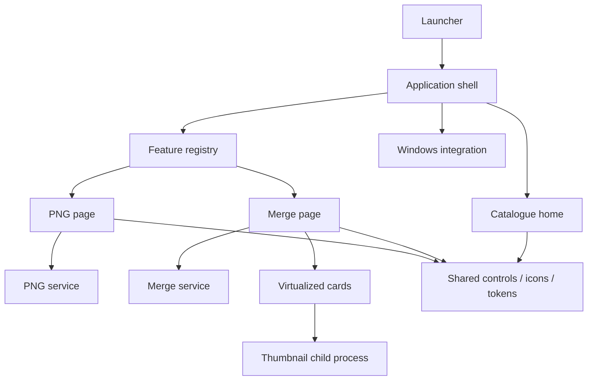

# Application structure

Explore the checked [Archify diagrams](DIAGRAMS.md) for the component map,
document-processing path and development/distribution flow. Their JSON sources,
delivered HTML and source-freshness manifest live in `docs/diagrams/`.

```text
PDF_LoveR/
├── main.py                         Windows/source launcher
├── pyproject.toml                  Package metadata and dependencies
├── pdf_lover/
│   ├── __main__.py                 Module/installed CLI entrypoint
│   ├── app.py                      Navigation, job guard, event dispatch
│   ├── version.py                  Single version source
│   ├── catalog.py                  Searchable tool descriptions/readiness
│   ├── assets/                     Packaged icons
│   ├── ui/                         Home, controls, icons, theme
│   ├── platform/                   Documents paths, native file drops
│   ├── features/
│   │   ├── base.py                 Page contract and shared busy state
│   │   ├── registry.py             Ready page factories
│   │   ├── png/                    PNG page and rendering engine
│   │   └── merge/                  Merge page, engine, cards, previews
│   └── diagnostics/                Packaged application smoke check
├── tests/
│   ├── unit/                       Engines and extension boundaries
│   └── ui/                         Native Windows behavior and performance
├── scripts/check.py                Sequential verification runner
├── packaging/                      Shared specs, build, installer, verification
├── docs/                           Product guides and verified results
└── dist/PDF_LoveR_<VERSION>/        Local generated distribution (ignored)
```

## Ownership and dependencies



The shell owns the route, one shared busy flag and one event-polling timer.
Each registered page owns its documents, settings, controls, result state and
worker-event queue. Pages are constructed on first use and retained when switching
tools; adding a registered tool does not construct another UI at startup.
`App.active_page` provides the current page; shortcuts and file drops dispatch
to its contract. Dropping on home opens merge, while Ctrl+O on home opens PNG.

PDF services can be imported and used without Tk or the shell. Shared UI does
not import feature pages. Windows integration calls the shell's public
`accept_paths()` interface rather than reaching into individual queues.
The registry validates that ready catalogue IDs exactly match executable pages.

## Work and lifecycle

The main thread owns Tk. Feature workers send queue events; the shell polls all
pages every 80 ms. The shared busy state prevents simultaneous tools from
processing or altering queues. Closing during processing leaves the application
open until completion. Root destruction cancels the shell's poll timer; native
drop callbacks cancel their deferred work; card destruction closes its preview
process and timers.

Merge cards use one Canvas and draw only rows near the viewport. Pointer input
is coalesced to 16 ms frames. Thumbnail UI updates pause during dragging and
resume after release. This design and its caches remain unchanged by the move.

## Packaging

`python -m pdf_lover`, `python main.py` and the installed `pdf-lover` command
share one entrypoint. It diverts frozen multiprocessing workers before importing
Tk. Both PyInstaller specs use `packaging/spec_common.py`, including native
TkDnD files and package assets. Inno Setup uses generated version definitions.
The package version and all Windows output filenames come from `version.py`.

See [Contributing](../CONTRIBUTING.md) for the extension procedure and
[Development](DEVELOPMENT.md) for runnable checks and builds.
