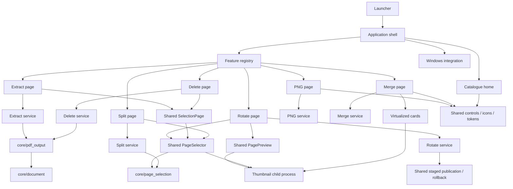

# Application structure

Explore the checked [Archify diagrams](DIAGRAMS.md) for the component map,
document-processing path and development/distribution flow. Their JSON sources,
delivered HTML and source-freshness manifest live in `docs/diagrams/`.

```text
PDF_LoveR/
├── main.py                         Windows/source launcher
├── pyproject.toml                  Package metadata and dependencies
├── pdf_lover/
│   ├── __main__.py                 Module/installed CLI entrypoint
│   ├── app.py                      Navigation, job guard, event dispatch
│   ├── version.py                  Single version source
│   ├── catalog.py                  Searchable tool descriptions/readiness
│   ├── assets/                     Packaged icons
│   ├── core/                       Page selection, document inspection and safe export
│   ├── ui/                         Home, controls, icons, theme
│   ├── platform/                   Documents paths, native file drops
│   ├── features/
│   │   ├── base.py                 Page contract and shared busy state
│   │   ├── registry.py             Ready page factories
│   │   ├── png/                    PNG page and rendering engine
│   │   ├── merge/                  Merge page, engine, cards
│   │   ├── split/                  Split page, immutable plan and safe engine
│   │   ├── selection_page.py       Shared extract/delete workbench
│   │   ├── extract/                Extract page and headless service
│   │   ├── rotate/                 Relative rotation, per-document selection, batch export
│   │   └── delete_pages/           Delete page and headless service
│   └── diagnostics/                Packaged application smoke check
├── tests/
│   ├── unit/                       Engines and extension boundaries
│   └── ui/                         Native Windows behavior and performance
├── scripts/check.py                Sequential verification runner
├── packaging/                      Shared specs, build, installer, verification
├── docs/                           Product guides and verified results
└── dist/PDF_LoveR_<VERSION>/        Local generated distribution (ignored)
```

## Ownership and dependencies



The shell owns the route, one shared busy flag and one event-polling timer.
Each registered page owns its documents, settings, controls, result state and
worker-event queue. Pages are constructed on first use and retained when switching
tools; adding a registered tool does not construct another UI at startup.
`App.active_page` provides the current page; shortcuts and file drops dispatch
to its contract. Dropping on home opens merge, while Ctrl+O on home opens PNG.

PDF services can be imported and used without Tk or the shell. Shared UI does
not import feature pages. Windows integration calls the shell's public
`accept_paths()` interface rather than reaching into individual queues.
The registry validates that ready catalogue IDs exactly match executable pages.

## Work and lifecycle

The main thread owns Tk. Feature workers send queue events; the shell polls
the active page every 80 ms; home polling backs off to 300 ms. The shared busy state prevents simultaneous tools from
processing or altering queues. Closing during processing leaves the application
open until completion. Root destruction cancels the shell's poll timer; native
drop callbacks cancel their deferred work; card destruction closes its preview
process and timers.

`App.preview_coordinator` owns a single lazily spawned renderer for all widgets.
ToolPage.set_active dispatches preview visibility to nested controls; hiding a
page releases images/pending requests and the merge preview timer while retaining
documents/settings. Home stops the renderer immediately; root destruction closes
it. PreviewWorker facades use client generations/required keys; the broker drops
stale replies and bounds requests to 16/results to 4. Busy pauses new submissions;
already queued bounded work may finish. Only the main thread creates Tk images.

PreviewCache limits entries and estimated raw/PIL/Tk copies: merge 48 entries/16 MiB,
selector 32/6 MiB, comparison 12/6 MiB. Hidden caches are empty. Fourfold pixel
accounting is an estimate, not an exact allocator/scaling guarantee; resource
benchmarks also measure Windows Private Bytes. Files reopen per preview request;
document/DisplayList caching remains planned. Registry factories import the page
module when used and verify its ToolPage contract on load. PNG releases each
full-page Pixmap in finally before rendering the next page.

Merge cards use one Canvas and draw only rows near the viewport. Pointer input
is coalesced to 16 ms frames. Thumbnail UI updates pause during dragging and
resume after release. The drag behavior and caches are preserved when sharing the preview engine.

## Packaging

`python -m pdf_lover`, `python main.py` and the installed `pdf-lover` command
share one entrypoint. It diverts frozen multiprocessing workers before importing
Tk. Both PyInstaller specs use `packaging/spec_common.py`, including native
TkDnD files and package assets. Inno Setup uses generated version definitions.
The package version and all Windows output filenames come from `version.py`.

See [Contributing](../CONTRIBUTING.md) for the extension procedure and
[Development](DEVELOPMENT.md) for runnable checks and builds.

## Shared page selection and split

`core/page_selection.py` parses ascending, one-based ranges and rejects duplicates,
reversed or overlapping groups and out-of-bounds pages. Each comma item is a group.
`ui/page_selector.py` consumes this model without importing any feature. It offers
all/none, editable ranges and a vertical Canvas viewport grid. It fills the panel's
remaining height, wraps into 1–4 columns and draws at most 24 intersecting cards;
only their thumbnails are requested. Wheel/scrollbar and arrow/Home/End/Page keys
scroll vertically; Space/Enter toggles the focused page. A 16-ms redraw coalesces
scroll events and is cancelled on hide/destroy; selection and scroll position remain.
Its bounded 32-entry/6-MiB estimated cache uses 180×200 fit thumbnails and the
app-wide 16-request limit in `ui/pdf_previews.py`; the old
merge import remains a compatibility facade. The shell polls both selectors and
active feature queue. Widget destruction unregisters its client; App owns child cleanup.

Split loads document metadata in a worker with the shared busy guard. The page
builds a frozen `SplitPlan` and shows groups, page counts and generated filenames
in a paged 25-row table. Every N pages includes the final shorter group. PDF work
uses that snapshot, checks the source stat signature/count again, stages all PDFs,
reopens each to verify the page count, and publishes exclusively. A collision or
failure rolls back only unchanged files created by that job; an incomplete rollback
is reported with the remaining names. The engine rejects original paths/aliases,
existing targets and invalid Windows name prefixes. No worker reads Tk variables.

PNG, merge, split, extract-pages and delete-pages and rotate are ready (6 of 34).
Organize remains planned. Password PDFs, general zoom preview, cancellation and
document-level attachments/signatures remain outside the page tools' scope.
See [Split](SPLIT.md) and [Page tools](PAGE_TOOLS.md) for precise behavior.

## Extract and delete pages

`features/selection_page.py` implements the common ToolPage workbench. Feature
pages configure its labels/modes and supply their own headless `service.py`.
Extraction saves selected ascending pages as one PDF or one file per selected
page. Deletion starts with no pages marked, computes the ordered complement and
rejects deleting everything. The 25-row preview maps output page numbers to
original numbers and shows filenames. Inspection/export run in worker threads;
only the main thread reads variables, renders controls and consumes queues.

`core/document.py` centralizes DocumentInfo, stat signatures, password checks and
Windows filename validation; split keeps compatibility imports. `core/pdf_output.py`
stages, reopens and checks every selected-page output before exclusive publication.
It rechecks the source and all targets before publishing, and rolls back only
unchanged files created by this job. Non-contiguous combined exports copy once
and remove omitted pages with PyMuPDF, preserving/remapping retained-page links,
widgets, annotations and rotations. Contiguous/single-page exports copy the range
directly. Bookmarks are mapped to retained pages with valid hierarchy levels.
Neither operation edits the source. This is page selection, not redaction.

Native checks cover both tools, Explorer drop, async inspection, retained state,
validation/recovery, 240-page bounded previews, 920x700 and 125% scaling. Independent
Poppler renders match the originals. Packaged smoke runs all six tool routes.
Its withdrawn window has a tiny Canvas viewport, so the smoke scrolls every
synthetic page through that viewport and verifies returned previews/cache budgets;
it never assumes all document thumbnails were loaded at once. Mapped-layout,
mouse and keyboard evidence comes from the separate native selector suite.

## Rotation

`features/rotate/service.py` builds a frozen RotationPlan across documents, with
separate ascending selections per document. The chosen 90/180/270 degrees adds to
each selected page's existing rotation modulo 360. Every page remains in place.
Names preserve the source stem plus a suffix; duplicate basenames receive stable
numbered names. Targets and every source signature are checked before work and
before publishing. All files are staged and reopened to verify counts/rotations;
`core/pdf_output.publish_staged` and `publication_error` share exclusive publication
and ownership-aware rollback with extract/delete. Directly saving the original
document in memory retains forms, annotations, links, bookmarks and attachments.

The RotatePage owns batch inputs, each document's expression, queues and controls.
`ui/page_preview.py` provides bounded before/after images for a navigable page, using
the same spawned renderer with an optional relative rotation and fit dimensions.
There are at most two pending comparison requests and 12 cached images (also bounded by a 6-MiB copy estimate). Empty
images stay alive to avoid CustomTkinter's image=None Tk lifetime issue. Existing
merge/selector request keys and dimensions retain their original behavior.
The filename dialog shows at most 25 rows and closes when settings change.

Native checks compare preview pixels with rendered rotation and final PDF output
with an independent Poppler render of reference /Rotate entries. A simple rotated
bitmap cannot provide exact PDF pixel equivalence because raster edge sampling
and no-rotate annotations differ. Source content is also checked after restoring
its original orientation. Password PDFs and preserving digital signature validity
are unsupported; general zoom/cancellation remain planned.

### Rotation command toolbar

The RotatePage uses shared outline Rotate Left/Right icons and native delayed
tooltips. Each command adds -90/+90 to the batch selection modulo 360, starting
at zero. Two clicks flip orientation, four restore it; zero shows identical
before/after previews and disables publication. Selections remain per-document
and the cumulative angle applies to the selected pages across the batch.
Toolbar commands support mouse and Enter/Space through shared UIControls.
They are disabled during inspection/export; tooltip timers/windows close on
leave, focus loss, processing and widget destruction. PDF services are unchanged.

## Low-spec review guard

AGENTS requires consideration of 2-core/4-GiB/HDD PCs for every update. The managed
pre-commit hook runs diagram freshness plus `scripts/check_low_spec.py --staged`.
`docs/low-spec-review.json` records memory, CPU/UI, disk/startup, dependencies and
quality impact, a complete source snapshot and hashes of passed JSON evidence.
The checker rejects stale/missing/partially staged evidence. It proves that reviewed
source/evidence match; physical low-spec support awaits tests on that hardware.

### Page selection gestures

PageSelector owns the shared Shift/Ctrl click and keyboard range anchor, and a temporary marquee.
The Tk-free ui/page_gestures.py calculates intersections from grid geometry, including offscreen rows.
Pointer bursts coalesce into one 16-ms draw; live feedback checks only visible cards. The expression
and feature plan change once on release, never per pointer event. Ctrl toggles intersections; Shift
adds them; an unmodified marquee replaces the selection. Edge scrolling uses one 60-ms root timer.
Escape, hide, document replacement, resizing, focus loss and disabling cancel the marquee and release its grab/timer.
Shift-click replaces the anchor range; Ctrl+Shift adds it. Plain card clicks retain toggle behavior.
No additional worker or dependency; automatic split modes and busy controls remain readonly.

## Document workbench · 1.6.0

`ui/workbench.py` composes the shared split/extract/delete and rotation layouts inside
ToolPage. It owns no PDF engine, queue or worker. The document grid receives most
remaining height; options scroll independently and save/open actions remain visible.
Home defaults to six ready tools, with an explicit catalogue toggle. Shared Thai fonts
are 16/18/20/25 logical px; controls remain 44 px. Merge cards are 240 px tall, minimum
220 px wide, with larger existing first-page previews and the same virtualized drag path.
PagePreview uses 320×400 fit images and original/result tabs on narrow panels; wider
panels may compare side by side. Its cache/pending limits and visibility cleanup remain
unchanged. No worker, service, export quality, runtime dependency or readiness changes.
See [locked design](../design.md) and [UX review](REDESIGN.md).

## Document desk 1.7.0

Home uses full-width compact task rows and category dropdown, all six visible at minimum size. Shared ui/navigation.py builds graphite masthead and direct ready-tool switcher on all six ToolPage pages; App still owns routing/busy guards, lazy pages and retained state. White selector sheets and selected footer tags on document-desk Canvas preserve original hit boxes and viewport bounds. No new service/worker/cache.
