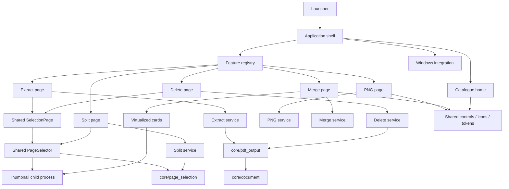

# Application structure

Explore the checked [Archify diagrams](DIAGRAMS.md) for the component map,
document-processing path and development/distribution flow. Their JSON sources,
delivered HTML and source-freshness manifest live in `docs/diagrams/`.

```text
PDF_LoveR/
├── main.py                         Windows/source launcher
├── pyproject.toml                  Package metadata and dependencies
├── pdf_lover/
│   ├── __main__.py                 Module/installed CLI entrypoint
│   ├── app.py                      Navigation, job guard, event dispatch
│   ├── version.py                  Single version source
│   ├── catalog.py                  Searchable tool descriptions/readiness
│   ├── assets/                     Packaged icons
│   ├── core/                       Page selection, document inspection and safe export
│   ├── ui/                         Home, controls, icons, theme
│   ├── platform/                   Documents paths, native file drops
│   ├── features/
│   │   ├── base.py                 Page contract and shared busy state
│   │   ├── registry.py             Ready page factories
│   │   ├── png/                    PNG page and rendering engine
│   │   ├── merge/                  Merge page, engine, cards
│   │   ├── split/                  Split page, immutable plan and safe engine
│   │   ├── selection_page.py       Shared extract/delete workbench
│   │   ├── extract/                Extract page and headless service
│   │   └── delete_pages/           Delete page and headless service
│   └── diagnostics/                Packaged application smoke check
├── tests/
│   ├── unit/                       Engines and extension boundaries
│   └── ui/                         Native Windows behavior and performance
├── scripts/check.py                Sequential verification runner
├── packaging/                      Shared specs, build, installer, verification
├── docs/                           Product guides and verified results
└── dist/PDF_LoveR_<VERSION>/        Local generated distribution (ignored)
```

## Ownership and dependencies



The shell owns the route, one shared busy flag and one event-polling timer.
Each registered page owns its documents, settings, controls, result state and
worker-event queue. Pages are constructed on first use and retained when switching
tools; adding a registered tool does not construct another UI at startup.
`App.active_page` provides the current page; shortcuts and file drops dispatch
to its contract. Dropping on home opens merge, while Ctrl+O on home opens PNG.

PDF services can be imported and used without Tk or the shell. Shared UI does
not import feature pages. Windows integration calls the shell's public
`accept_paths()` interface rather than reaching into individual queues.
The registry validates that ready catalogue IDs exactly match executable pages.

## Work and lifecycle

The main thread owns Tk. Feature workers send queue events; the shell polls all
pages every 80 ms. The shared busy state prevents simultaneous tools from
processing or altering queues. Closing during processing leaves the application
open until completion. Root destruction cancels the shell's poll timer; native
drop callbacks cancel their deferred work; card destruction closes its preview
process and timers.

Merge cards use one Canvas and draw only rows near the viewport. Pointer input
is coalesced to 16 ms frames. Thumbnail UI updates pause during dragging and
resume after release. The drag behavior and caches are preserved when sharing the preview engine.

## Packaging

`python -m pdf_lover`, `python main.py` and the installed `pdf-lover` command
share one entrypoint. It diverts frozen multiprocessing workers before importing
Tk. Both PyInstaller specs use `packaging/spec_common.py`, including native
TkDnD files and package assets. Inno Setup uses generated version definitions.
The package version and all Windows output filenames come from `version.py`.

See [Contributing](../CONTRIBUTING.md) for the extension procedure and
[Development](DEVELOPMENT.md) for runnable checks and builds.

## Shared page selection and split

`core/page_selection.py` parses ascending, one-based ranges and rejects duplicates,
reversed or overlapping groups and out-of-bounds pages. Each comma item is a group.
`ui/page_selector.py` consumes this model without importing any feature. It offers
all/none, editable ranges and four selectable page thumbnails per view. Its bounded
32-entry cache and at most four pending requests use `ui/pdf_previews.py`; the old
merge import remains a compatibility facade. The shell polls both selectors and
feature queues, and widget destruction closes the child process.

Split loads document metadata in a worker with the shared busy guard. The page
builds a frozen `SplitPlan` and shows groups, page counts and generated filenames
in a paged 25-row table. Every N pages includes the final shorter group. PDF work
uses that snapshot, checks the source stat signature/count again, stages all PDFs,
reopens each to verify the page count, and publishes exclusively. A collision or
failure rolls back only unchanged files created by that job; an incomplete rollback
is reported with the remaining names. The engine rejects original paths/aliases,
existing targets and invalid Windows name prefixes. No worker reads Tk variables.

PNG, merge, split, extract-pages and delete-pages are ready (5 of 34).
Organize remains planned. Password PDFs, general zoom preview, cancellation and
document-level attachments/signatures remain outside the page tools' scope.
See [Split](SPLIT.md) and [Page tools](PAGE_TOOLS.md) for precise behavior.

## Extract and delete pages

`features/selection_page.py` implements the common ToolPage workbench. Feature
pages configure its labels/modes and supply their own headless `service.py`.
Extraction saves selected ascending pages as one PDF or one file per selected
page. Deletion starts with no pages marked, computes the ordered complement and
rejects deleting everything. The 25-row preview maps output page numbers to
original numbers and shows filenames. Inspection/export run in worker threads;
only the main thread reads variables, renders controls and consumes queues.

`core/document.py` centralizes DocumentInfo, stat signatures, password checks and
Windows filename validation; split keeps compatibility imports. `core/pdf_output.py`
stages, reopens and checks every selected-page output before exclusive publication.
It rechecks the source and all targets before publishing, and rolls back only
unchanged files created by this job. Non-contiguous combined exports copy once
and remove omitted pages with PyMuPDF, preserving/remapping retained-page links,
widgets, annotations and rotations. Contiguous/single-page exports copy the range
directly. Bookmarks are mapped to retained pages with valid hierarchy levels.
Neither operation edits the source. This is page selection, not redaction.

Native checks cover both tools, Explorer drop, async inspection, retained state,
validation/recovery, 240-page bounded previews, 920x700 and 125% scaling. Independent
Poppler renders match the originals. Packaged smoke runs all five tool routes.
