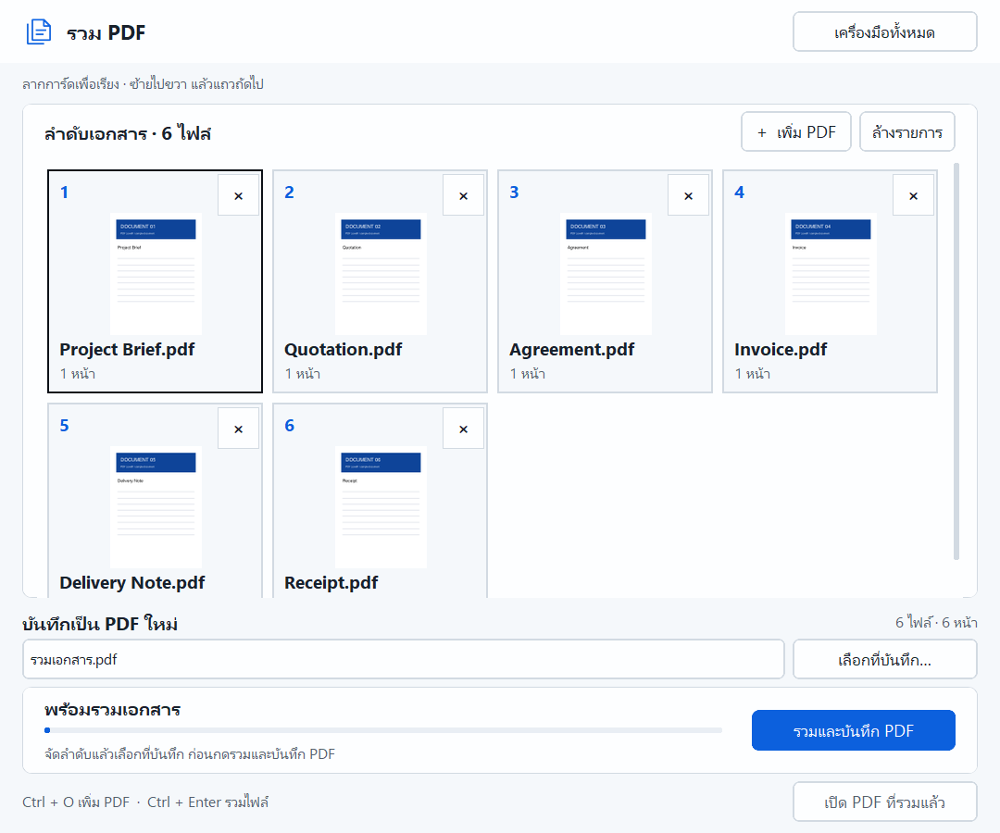
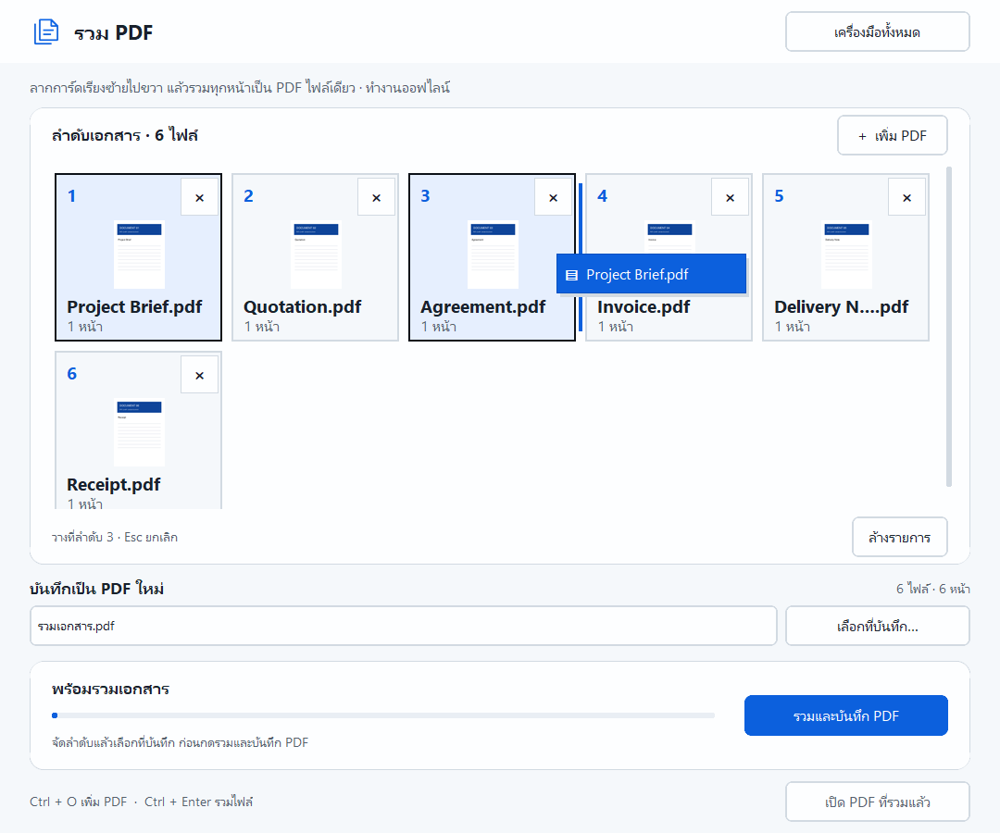

# รวม PDF

รวมหลายเอกสารเป็น PDF ไฟล์เดียวตามลำดับที่คุณเลือก ทำงานออฟไลน์



เมื่อกดลาก การ์ดจะยกตัวพร้อมเงา และเส้นสีน้ำเงินจะแสดงจุดที่ไฟล์จะถูกวาง



1. จากหน้าแรก เลือก **รวม PDF → เปิดเครื่องมือ**
2. กด **เพิ่ม PDF** แล้วเลือกอย่างน้อย 2 ไฟล์
3. กดค้างบนการ์ดแล้ว **ลากจัดลำดับ** ซ้ายไปขวา แล้วขึ้นแถวใหม่ ใช้ **×** นำไฟล์ออก
4. กด **เลือกที่บันทึก…** เพื่อเลือกตำแหน่งและชื่อไฟล์ใหม่
5. กด **รวมและบันทึก PDF** แล้วกด **เปิด PDF ที่รวมแล้ว** เมื่อเสร็จ

โปรแกรมรวมทุกหน้าในแต่ละไฟล์ ไม่เลือกเฉพาะบางหน้าในเครื่องมือนี้
ไฟล์เดิมจะไม่ถูกเขียนทับ หากปลายทางมีอยู่แล้ว ให้เลือกชื่อใหม่
ลำดับและที่บันทึกยังอยู่เมื่อกลับหน้าแรกหรือสลับเครื่องมือ

ลากใกล้ขอบบนหรือล่างเพื่อเลื่อนรายการอัตโนมัติ กด **Esc** เพื่อยกเลิก
ระหว่างลาก โปรแกรมพักการแสดงภาพตัวอย่างใหม่ แล้วทำต่อเมื่อปล่อยเมาส์

ใช้ **Tab** โฟกัสการ์ด แล้วใช้ปุ่มลูกศรจัดลำดับได้ด้วย

## รองรับใน 1.1.3

- หน้าต่างที่ปรับขนาดได้ และ Windows scaling 100% / 125%
- ข้อความ ภาพ ขนาดหน้า และการหมุนหน้าของเอกสาร
- ลิงก์ภายในหน้าและลิงก์เว็บไซต์ หมายเหตุ และช่องแบบฟอร์มที่ทดสอบ
- บุ๊กมาร์กตามชื่อไฟล์ พร้อมนำบุ๊กมาร์กที่ชี้ไปยังหน้าของต้นฉบับมาจัดลำดับใหม่
- แจ้งไฟล์ที่เปิดไม่ได้ และปลดล็อกปุ่มให้ลองอีกครั้งหากรวมไม่สำเร็จ

PDF ที่ต้องใส่รหัสผ่านยังไม่รองรับ
การรวมสร้างเอกสารใหม่ จึงไม่รับรองลายเซ็นดิจิทัลเดิม
ไฟล์แนบ และการตั้งค่าระดับเอกสารของต้นฉบับไม่ได้ถูกรวมเข้าด้วยกัน
บุ๊กมาร์กที่ชี้ไปนอกเอกสารไม่ได้ถูกนำมารวม

Release 1.0.0 ยังเป็นตัวแปลง PNG เดิม เครื่องมือรวมอยู่ในซอร์สรุ่นพัฒนาและชุด Preview

## สำหรับผู้พัฒนา

`pdf_merge.py` ใช้ [PyMuPDF insert_pdf](https://pymupdf.readthedocs.io/en/latest/document.html#Document.insert_pdf)
คัดลอกหน้าโดยไม่เรนเดอร์เป็นภาพ และใช้ `join_duplicates=False` เพื่อให้ช่องแบบฟอร์มชื่อซ้ำแยกกัน
ต้องใช้ PyMuPDF 1.25.5+ การบันทึกใช้ไฟล์ชั่วคราวในโฟลเดอร์เดียวกับปลายทาง
ตรวจจำนวนหน้าก่อนเผยแพร่ผลลัพธ์ โดยไม่แทนที่ไฟล์ที่มีอยู่

```powershell
python -m unittest discover -s tests -v
python .hallmark/verify_merge.py
```

การตรวจ UI ใช้ Poppler `pdftoppm` ใน PATH เพื่อเทียบภาพต้นฉบับกับผลลัพธ์โดยอิสระ
ผลการตรวจล่าสุดอยู่ใน [merge-verification.json](merge-verification.json)

ตรวจการลากจริงด้วย `python tests/verify_merge_cards.py` (Windows)
