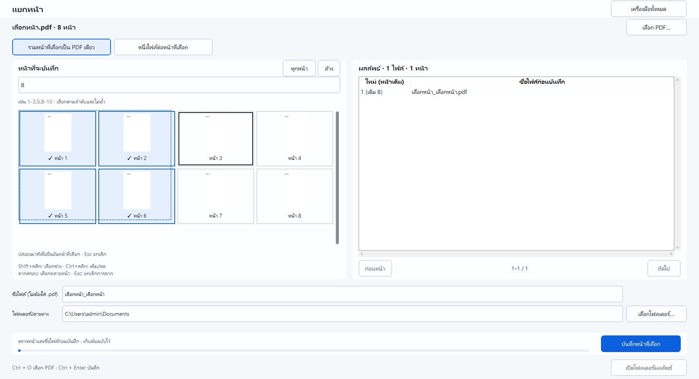

# เลือกหลายหน้า · 1.5.4

ใช้กับแยก PDF แบบตามช่วง, แยกหน้า, ลบหน้า และหมุน PDF
ภาพหน้าเอกสารเรียงหลายแถวและเลื่อนลงได้

- **Shift+คลิก** เลือกช่วงจากหน้าที่คลิกล่าสุด เช่น คลิกหน้า 3 แล้ว Shift+คลิกหน้า 7 ได้ `3-7`; เลือกย้อนกลับได้
- **Ctrl+คลิก** เพิ่มหรือเอาหน้านั้นออกจากชุดที่เลือก
- **Ctrl+Shift+คลิก** เพิ่มทั้งช่วงโดยเก็บหน้าอื่นที่เลือกไว้
- **ลากครอบ** เลือกทุกการ์ดที่กรอบแตะ เริ่มลากจากช่องว่างหรือบนการ์ดได้; ลากถึงขอบบน/ล่างเพื่อเลื่อนต่อ
- **Ctrl+ลากครอบ** สลับเลือก/ยกเลิกหน้าที่กรอบแตะ; **Shift+ลากครอบ** เพิ่มหน้าที่กรอบแตะ
- **Esc** ยกเลิกการลากและใช้หน้าที่เลือกไว้ก่อนลาก
- **Shift+ลูกศร** ขยายหรือหดช่วง; **Ctrl+A** เลือกทุกหน้าเมื่อโฟกัสอยู่ในตารางภาพ

คลิกการ์ดธรรมดายังคงเลือกหรือยกเลิกทีละหน้าได้ พิมพ์ช่วงหน้าเองได้เช่นเดิม
ระหว่างลาก สีและเครื่องหมายถูกแสดงหน้าที่กำลังเลือก; ช่องช่วงหน้าและตารางผลลัพธ์จะอัปเดตตอนปล่อยเมาส์
ตรวจชื่อไฟล์และหน้าที่จะได้ก่อนกดบันทึก การเลือกหน้าไม่เปลี่ยนต้นฉบับ

โหมดแยกทุกหน้า/ทุก N หน้าใช้ทุกหน้าอัตโนมัติ จึงแก้การเลือกไม่ได้; ระหว่างประมวลผลจะล็อกการเลือก
เปลี่ยนเครื่องมือ เอกสาร ขนาดหน้าต่าง หรือย้ายโฟกัสออกจากตารางขณะลากจะยกเลิกการลากที่ยังไม่ยืนยัน

ตรวจด้วย PDF ข้อความ 1,000 หน้าและ pointer input 1,000 ครั้ง: [หลักฐานการเลือกหลายหน้า](page-gestures-verification-1.5.4.json)
วาดเฉพาะหน้าที่อยู่ในพื้นที่แสดงผลไม่เกิน 24 การ์ด ใช้ process ภาพร่วมตัวเดิมและคิวไม่เกิน 16
ผลบนเครื่องพัฒนาไม่ใช่การรับรอง PC RAM 4 GiB/HDD จริง
