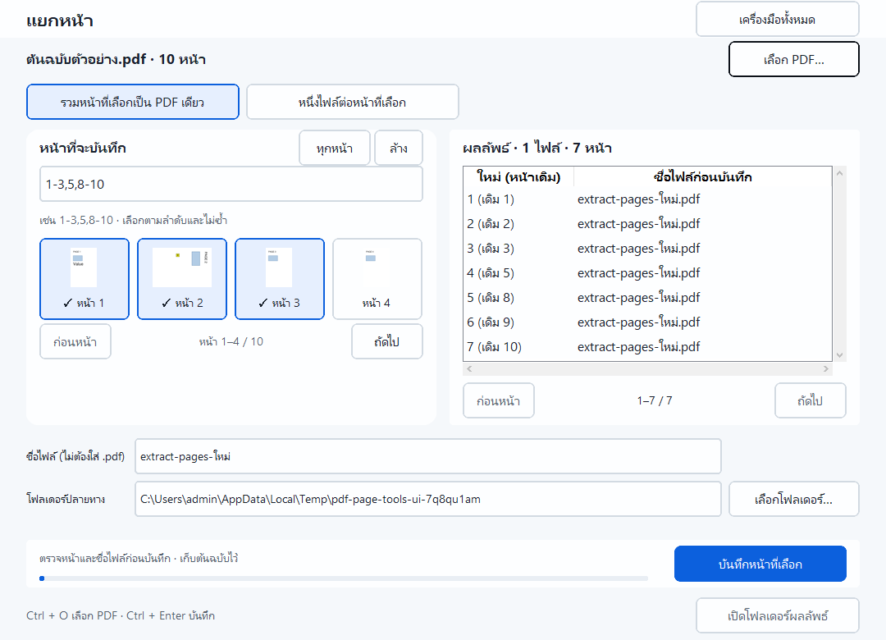
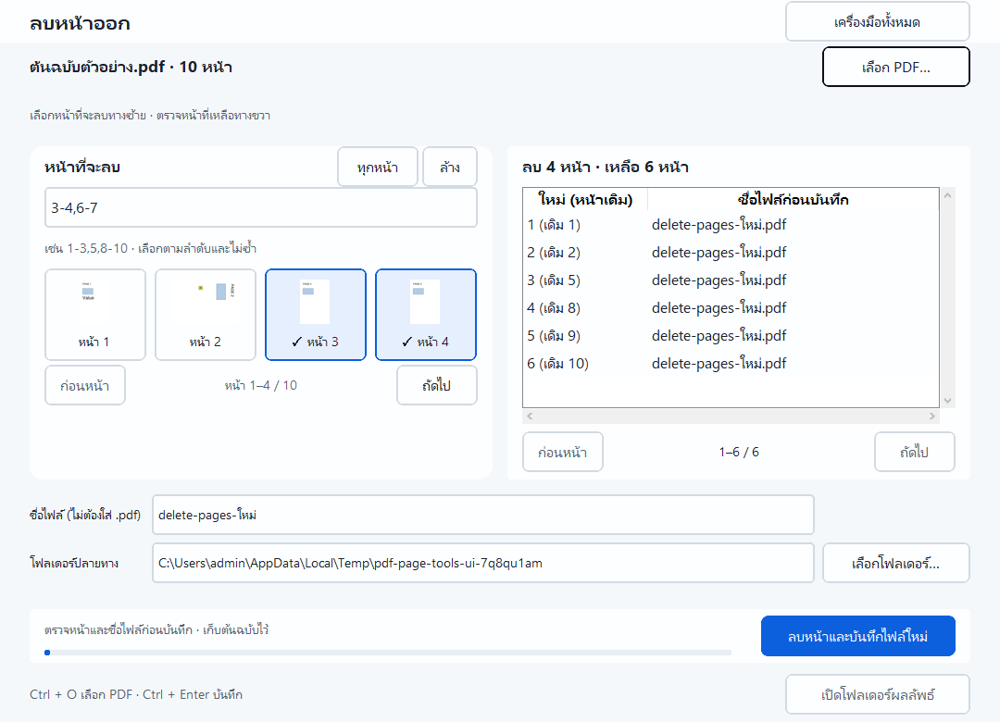

# แยกหน้าและลบหน้าออก · PDF LoveR 1.4.0

ทั้งสองเครื่องมือรับ PDF ครั้งละหนึ่งไฟล์ เลือกจากปุ่ม **เลือก PDF…** หรือ
ลากจาก Explorer ลงบนหน้าเครื่องมือ ปลายทางเริ่มที่ Documents และบันทึกเป็นไฟล์ใหม่

## แยกหน้า

1. เปิด **แยกหน้า** แล้วเลือกต้นฉบับ
2. กดภาพหน้าที่ต้องการ หรือกรอกช่วง เช่น `1-3,5,8-10`; กด **ทุกหน้า** หรือ **ล้าง** ได้
3. เลือก **รวมหน้าที่เลือกเป็น PDF เดียว** หรือ **หนึ่งไฟล์ต่อหน้าที่เลือก**
4. ตรวจตารางเลขหน้าใหม่กับหน้าเดิม และชื่อไฟล์ก่อนบันทึก
5. ใส่ชื่อโดยไม่ต้องเติม `.pdf`, เลือกโฟลเดอร์ แล้วกด **บันทึกหน้าที่เลือก**

PDF เดียวจะรวมทุกหน้าที่เลือก เช่น `1-3,5` ได้สี่หน้าตามลำดับเดิม
หนึ่งไฟล์ต่อหน้าจะได้ชื่อ เช่น `งาน_001_p001.pdf`, `งาน_002_p002.pdf`, `งาน_003_p003.pdf`, `งาน_004_p005.pdf`
ต่างจากเครื่องมือ **แยก PDF** ซึ่งแยกแต่ละช่วง comma เป็นหนึ่งไฟล์

## ลบหน้าออก

1. เปิด **ลบหน้าออก** แล้วเลือกต้นฉบับ; เริ่มโดยยังไม่มีหน้าถูกเลือกให้ลบ
2. เลือกภาพหรือกรอกช่วงของหน้าที่จะลบ
3. ตรวจข้อความ **ลบ … หน้า · เหลือ … หน้า** และตารางหน้าที่จะเก็บ
4. ตั้งชื่อและโฟลเดอร์ แล้วกด **ลบหน้าและบันทึกไฟล์ใหม่**

ตัวอย่าง: ต้นฉบับสิบหน้า ลบ `3-4,6-7` จะได้หน้าเดิม `1,2,5,8,9,10`
เรียงเป็นหน้าที่ 1–6 ใน PDF ใหม่ ต้องเหลืออย่างน้อยหนึ่งหน้า

## ช่วงหน้าและการรักษาไฟล์

- เลขหน้าเริ่มที่ 1 ต้องเรียงจากน้อยไปมาก ห้ามหน้าซ้ำ ช่วงทับกัน ย้อนลำดับ หรือเกินจำนวนหน้า
- โปรแกรมปฏิเสธชื่อไฟล์ที่ Windows ใช้ไม่ได้ ปลายทางต้นฉบับ/alias และไฟล์ที่มีอยู่แล้ว
- ถ้ามีไฟล์ชื่อชนระหว่างบันทึก จะเก็บไฟล์นั้นและคืนไฟล์ที่งานนี้เพิ่งสร้าง; ถ้าคืนไม่ได้จะระบุชื่อที่เหลือ
- ตรวจต้นฉบับอีกครั้งก่อนและหลังสร้างผลลัพธ์ ถ้าไฟล์เปลี่ยนต้องเลือกใหม่
- เตรียมทุกไฟล์ในโฟลเดอร์ชั่วคราวและเปิดตรวจจำนวนหน้าก่อนเผยแพร่ผลลัพธ์
- หน้าที่เก็บไว้รักษาข้อความ ภาพ ขนาด มุมหมุน หมายเหตุ ฟอร์ม และลิงก์ระหว่างหน้าที่เหลือ
  บุ๊กมาร์กชี้ไปยังเลขหน้าใหม่; ลิงก์และบุ๊กมาร์กที่ชี้หน้าซึ่งไม่ถูกเก็บจะถูกตัดออก
- ไม่รองรับ PDF มีรหัสผ่าน เอกสารแนบระดับไฟล์ และการรักษาลายเซ็นดิจิทัลในรุ่นนี้
- ลบหน้าเป็นการจัดหน้าเอกสาร; หากต้องกำจัดข้อมูลลับต้องใช้เครื่องมือปิดบังข้อมูลที่ตรวจการลบเนื้อหาจริง

ภาพตัวอย่างแสดงทีละสี่หน้า ตารางผลลัพธ์ทีละ 25 รายการ มีปุ่มก่อนหน้า/ถัดไป
ใช้ **Ctrl+O** เลือกไฟล์ และ **Ctrl+Enter** บันทึกได้ ระหว่างทำงานปุ่มและการสลับเครื่องมือถูกล็อก

หลักฐาน: [native UI และ Poppler](page-tools-verification.json),
unit tests ใน `tests/unit/test_page_tools.py`, และ smoke ของ EXE/ZIP/installer
ใน [ผลตรวจชุดแจก](distribution-1.4.0.json)
