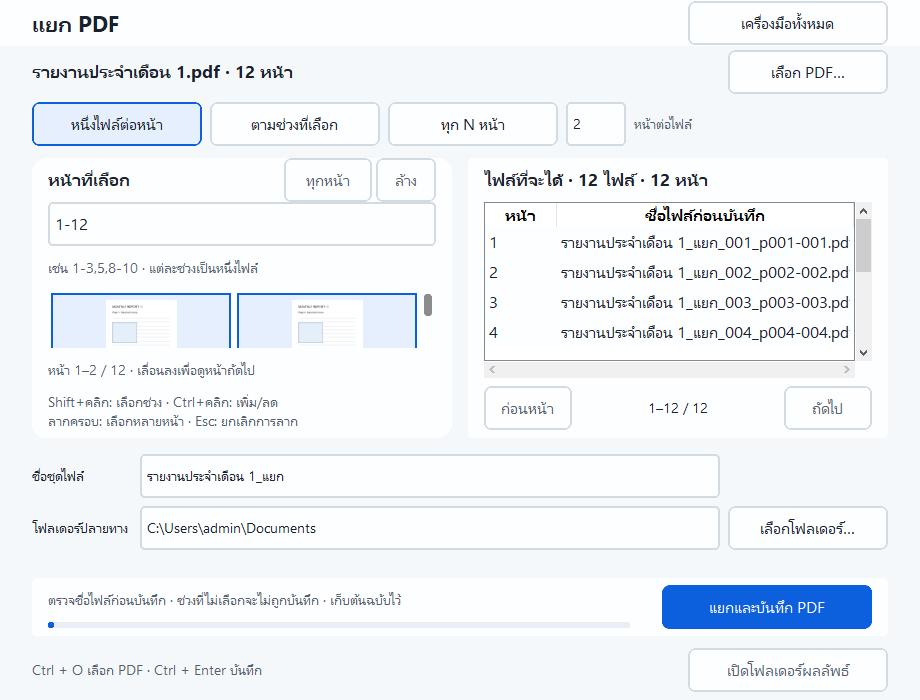
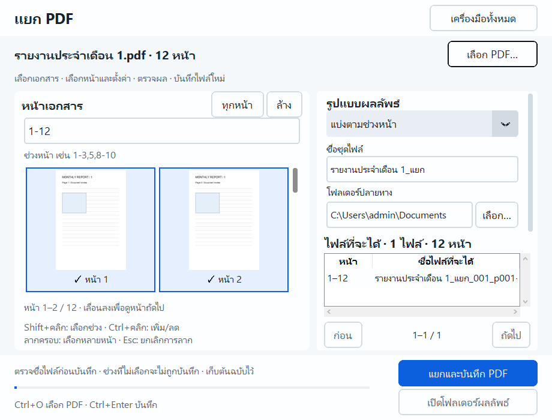
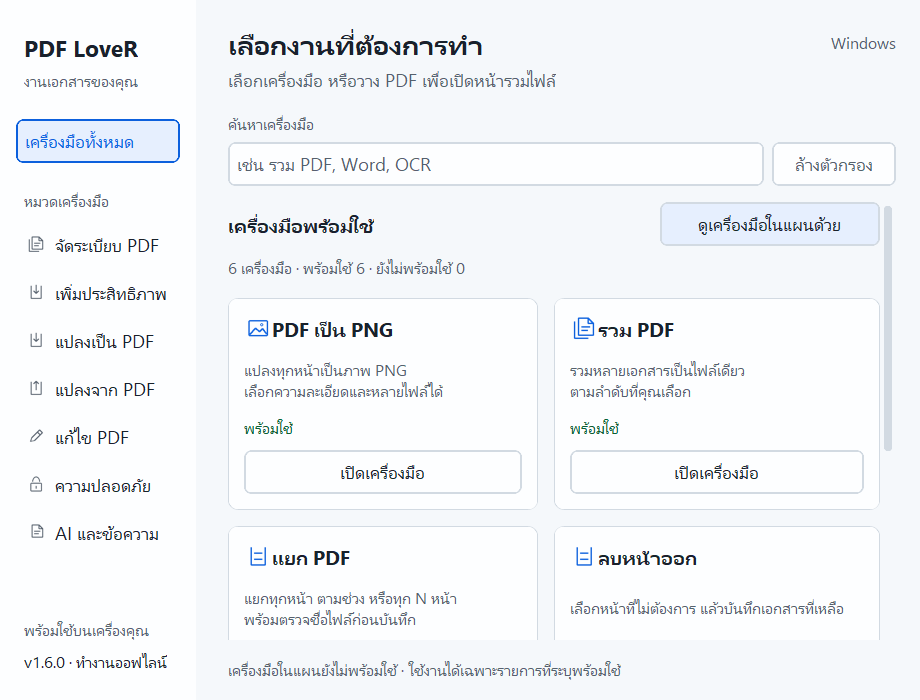
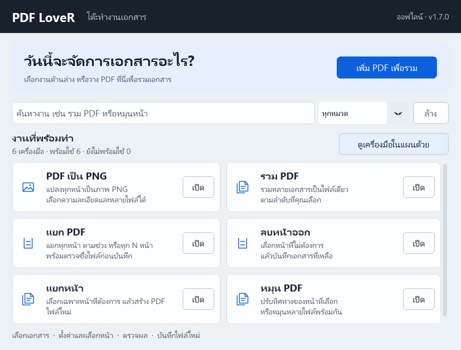
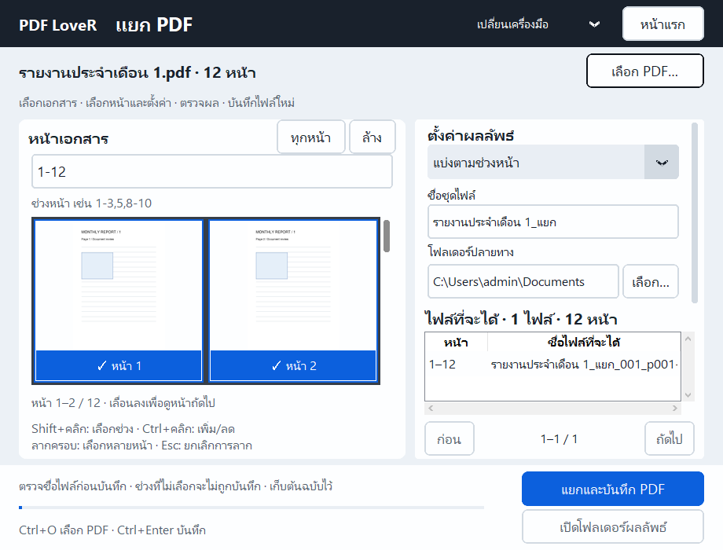

# PDF LoveR 1.6.0 · ตรวจเอกสารได้สะดวกขึ้น

## Audit จากโปรแกรมจริง

ภาพก่อนปรับที่ 920×700 แสดงตัวเลือกหน้าเหลือพื้นที่แนวตั้งน้อย (ประมาณ 55 logical px ใน layout เดิม), thumbnail 144×112 เล็กสำหรับตรวจหน้า ขณะที่ตัวเลือกและชื่อไฟล์กินพื้นที่ด้านบนหลายแถว ปุ่มหลักและผลลัพธ์กระจายกัน หน้าแรกแสดงเครื่องมือในแผนร่วมกับเครื่องมือพร้อมใช้และมีแถบ PNG ซ้ำ

## มาตรฐานร่วม

ใช้ Leelawadee UI: หัวข้อ 25, หัวข้อรอง 20, เนื้อหา 18, คำแนะนำ 16 logical px; controls สูง 44, spacing 4/8/12/16/24 และ palette Cobalt เดิมของ PDF LoveR รายละเอียดใน [design.md](../design.md)
เลือกเอกสาร → ตั้งค่า/เลือกหน้า → ตรวจผล → บันทึก: เอกสารอยู่ซ้าย, settings/ชื่อผลลัพธ์อยู่ขวา, ปุ่มบันทึกและเปิดโฟลเดอร์อยู่แถบล่างถาวร สี focus และ Enter/Space รองรับปุ่มร่วม; output dropdown รองรับ Tab/Enter/Space/Alt+Down

## ทั้ง 6 เครื่องมือ

- หน้าแรกเริ่มด้วย 6 เครื่องมือพร้อมใช้; ผู้ใช้เปิดดู 28 เครื่องมือในแผนได้โดยมีข้อความว่า “ยังไม่พร้อมใช้”
- PDF เป็น PNG: ข้อความ/controls ใหญ่ขึ้น ลด padding ซ้ำ รักษา queue, DPI 36–600 และการแปลงทุกหน้า
- รวม PDF: การ์ดสูง 240, ภาพหน้าแรกแสดงใหญ่ขึ้น, ชื่อ/จำนวนหน้าอยู่ใต้ภาพ; ปุ่มล้างคิวอยู่กับเพิ่มไฟล์ รักษาลากข้ามแถวและ keyboard reorder
- แยก PDF / แยกหน้า / ลบหน้า: workbench ร่วม, selector viewport หลายแถวเลื่อนแนวตั้ง, settings ด้านขวาเลื่อนแยกจากตารางผลลัพธ์; mode dropdown ช่วยลดพื้นที่แนวตั้ง ผลลัพธ์มีตารางและ pagination
- หมุน PDF: icon ซ้าย/ขวากดซ้ำทีละ 90°, แท็บต้นฉบับ/ผลลัพธ์ที่ rail แคบ; panel กว้างจึงแสดงคู่ได้ settings/ชื่อทั้งหมดเข้าถึงด้วยการเลื่อน rail ปุ่มบันทึกอยู่นอก rail

## หลักฐานและขอบเขต

[Native geometry](workbench-verification-1.6.0.json) ตรวจ 920×700, 1080×780, 1440×900 ที่ scaling 100%/125%, home+6 tools, empty/loaded/error/disabled และ cleanup; suite เดิมตรวจ export/success, shortcuts, focus/input, drop, gestures และ lifecycle
selector ใช้ 180×200-fit ไม่เกิน 24 visible cards, cache 32/6 MiB; comparison 320×400-fit cache 12/6 MiB; shared request/result limits เดิม
ภาพเป็น navigation preview ไม่ใช่เครื่องมือ zoom/full-resolution อ่านละเอียดและไม่เปลี่ยนคุณภาพ export
ตารางผลลัพธ์ที่หน้าต่างขั้นต่ำเห็นหัวตารางและอย่างน้อยหนึ่งแถว ต้องเลื่อนเมื่อมีรายการมาก; split chunks และ rotation settings ใช้ rail scrolling
ตรวจด้วย source app และ frozen self-test บน Windows 10 เครื่องพัฒนา ไม่รับรองเครื่อง low-spec จริงหรือ Windows 11; [low-spec review](low-spec-review.json) และ [ผลวัด](performance-after-1.6.0.json)

## ภาพก่อน–หลังจริง

ภาพ native HWND จาก fixture 12-page PDF; ไม่ใช่ mockup ทั้งชุดใน `docs/images/redesign/` รวม empty/error และ 100%/125%

| ก่อน · 920×700 100% | หลัง · 920×700 100% |
|---|---|
|  |  |

[Home หลัง](images/redesign/after-home-1.png) · [Merge หลัง](images/redesign/after-merge-1.png) · [Rotate หลัง](images/redesign/after-rotate-1.png) · [125%](images/redesign/after-split-1.25.png)

# ยกเครื่องโครงหน้าจอ · 1.7.0

ผู้ใช้เห็นว่า 1.6.0 ยังเหมือนเดิม จึงปรับโครงสร้างทั้งระบบ: หน้าแรกไม่มี category sidebar และการ์ดสูงแล้ว ใช้ task rows เต็มความกว้าง เห็น 6 งานพร้อมใช้ที่ 920×700, การค้นหาและ dropdown หมวดอยู่แถวเดียว, document start area อยู่บนสุด
เครื่องมือทั้งหมดใช้ masthead ใหม่และเมนูเปลี่ยนเครื่องมือโดยตรง ไม่จำเป็นต้องกลับหน้าแรกก่อน; คงเอกสาร/ค่าของแต่ละ ToolPage และ App busy guard ตัวเดิม
selector เป็นโต๊ะสีเข้ม แผ่นหน้าสีขาวและ selected footer; hit geometry, shortcuts, gesture, queue/cache และ service เดิม
[หลักฐาน 1.7.0](verification-1.7.0.json) · [ชุดตรวจ workspace](workbench-verification-1.7.0.json)

| 1.6.0 | 1.7.0 |
|---|---|
|  |  |
|  |  |
