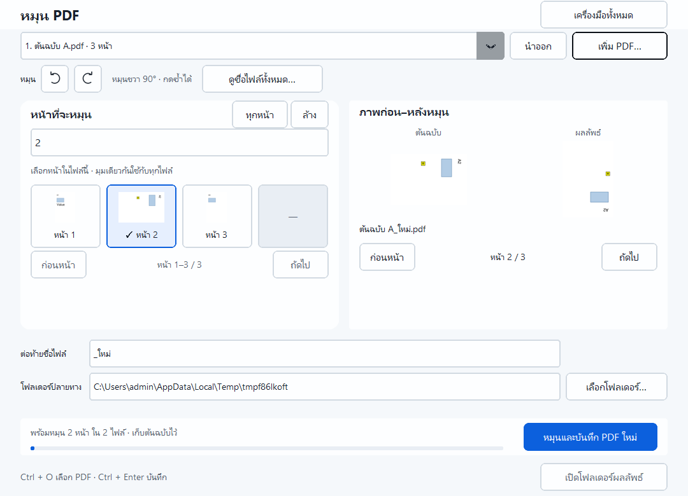

# หมุน PDF · PDF LoveR 1.5.1

1. เปิด **หมุน PDF** แล้วเพิ่ม PDF หนึ่งไฟล์หรือหลายไฟล์; ลากจาก Explorer ได้
2. เลือกเอกสารจากรายการด้านบน เพื่อเลือกหน้าในแต่ละไฟล์
3. กดภาพหน้า กรอกช่วงเช่น `1-3,5` หรือกด **ทุกหน้า**; แต่ละเอกสารจำช่วงของตนเอง
4. กดไอคอนลูกศรโค้ง **หมุนซ้าย** หรือ **หมุนขวา** ครั้งละ 90° กดซ้ำเพื่อหมุนต่อ
5. ดูภาพต้นฉบับกับผลลัพธ์ และใช้ปุ่มก่อนหน้า/ถัดไปตรวจหน้าอื่น
6. กด **ดูชื่อไฟล์ทั้งหมด…** เพื่อตรวจต้นฉบับ หน้าที่หมุน และชื่อไฟล์ใหม่ทั้งชุด
7. ตั้งข้อความต่อท้ายชื่อและโฟลเดอร์ แล้วกด **หมุนและบันทึก PDF ใหม่**

เริ่มต้นที่ทิศเดิม กดขวา 1/2/3 ครั้งจะหมุนเพิ่ม 90°/180°/270° กดครั้งที่ 4 กลับทิศเดิม
กดซ้ายเพื่อหมุนย้อนทีละ 90°; กดซ้าย–ขวาติดต่อกันจะหักล้างกัน ถ้ามุมกลับเป็น 0°
จะยังไม่บันทึกจนกว่าจะกดหมุนอีกครั้ง มุมสะสมเพิ่มจากมุมเดิมของหน้า เช่น หน้าเดิมหมุน 90°
กดขวาอีกครั้งจะได้ 180° มุมเดียวกันใช้กับหน้าที่เลือกในทุกไฟล์; หน้าที่ไม่ได้เลือกยังอยู่ในตำแหน่งและมุมเดิม
แถบปุ่มบอกทิศปัจจุบัน ชี้เมาส์หรือใช้ Tab โฟกัสไอคอนเพื่ออ่านชื่อปุ่ม; Enter/Space กดหมุนได้

ชื่อเริ่มต้นเช่น `งาน_หมุน.pdf` กรณีเอกสารจากคนละโฟลเดอร์มีชื่อเหมือนกัน
ไฟล์ถัดไปเติมเลข เช่น `งาน_หมุน_002.pdf` ถ้าปลายทางมีไฟล์นั้นอยู่แล้วจะปฏิเสธ
ให้เปลี่ยนข้อความต่อท้ายหรือโฟลเดอร์ การเปลี่ยนเอกสารในรายการใช้เลือกหน้าของแต่ละไฟล์;
ปุ่ม **นำออก** เอาเอกสารออกจากชุดงาน โดยไม่ลบไฟล์ต้นฉบับ

โปรแกรมเก็บทุกหน้า ข้อความ ภาพ ฟอร์ม ลิงก์ หมายเหตุ บุ๊กมาร์ก และเอกสารแนบ
ไม่แก้ต้นฉบับ และไม่ทับไฟล์เดิม ตรวจจำนวนหน้าและมุมในไฟล์ที่สร้างก่อนบันทึกทั้งชุด
ถ้าชื่อชนระหว่างบันทึก จะเก็บไฟล์ภายนอกและคืนไฟล์ที่งานนี้เพิ่งสร้าง; หากคืนไม่ได้จะแจ้งชื่อที่เหลือ
ถ้าต้นฉบับเปลี่ยนหลัง preview ต้องนำไฟล์นั้นออกแล้วเพิ่มใหม่

ช่วงหน้าต้องเรียงจากน้อยไปมาก ไม่ซ้ำ ไม่ย้อน และอยู่ภายในจำนวนหน้าของเอกสารนั้น
ต้องเลือกอย่างน้อยหนึ่งหน้าในแต่ละไฟล์; ไฟล์ที่ไม่ต้องการหมุนให้นำออกจากชุด
ถ้าเพิ่มหลายไฟล์แล้วมีไฟล์เปิดไม่ได้ การเพิ่มครั้งนั้นจะถูกยกเลิก โดยรายการที่เพิ่มก่อนหน้ายังคงอยู่

PDF มีรหัสผ่านยังไม่รองรับ การแก้เอกสารไม่รักษาความถูกต้องของลายเซ็นดิจิทัล
ภาพตัวอย่างยังไม่มีซูมเต็มหน้า และยังยกเลิกงานที่เริ่มแล้วไม่ได้
ปลายทางเริ่มที่ Documents ใช้ Ctrl+O เพิ่มไฟล์ และ Ctrl+Enter บันทึกได้

หลักฐาน: [native UI และ Poppler](rotate-verification.json),
[ผลตรวจชุดแจก](distribution-1.5.1.json), [สรุปการตรวจ](verification-1.5.1.json)

รูปแบบอ้างอิง: [Adobe Acrobat Rotate Page Left / Right](https://helpx.adobe.com/uk/acrobat/using/adjusting-pdf-views.html)
ใช้คำสั่งหมุนเพิ่มทีละ 90° และไอคอนลูกศรโค้ง; PDF LoveR บันทึกมุมลงสำเนา PDF จริง

ภาพหน้าที่เลือกเรียงหลายแถวและเลื่อนแนวตั้งตามพื้นที่ ใช้เมาส์หรือคีย์ลูกศร/Home/End/Page Up/Page Down; Space/Enter เลือกหน้า

เลือกหลายหน้าได้ด้วย **Shift+คลิก**, **Ctrl+คลิก** และ **ลากครอบ**; ดู [วิธีเลือกหน้า](PAGE_SELECTION.md)
