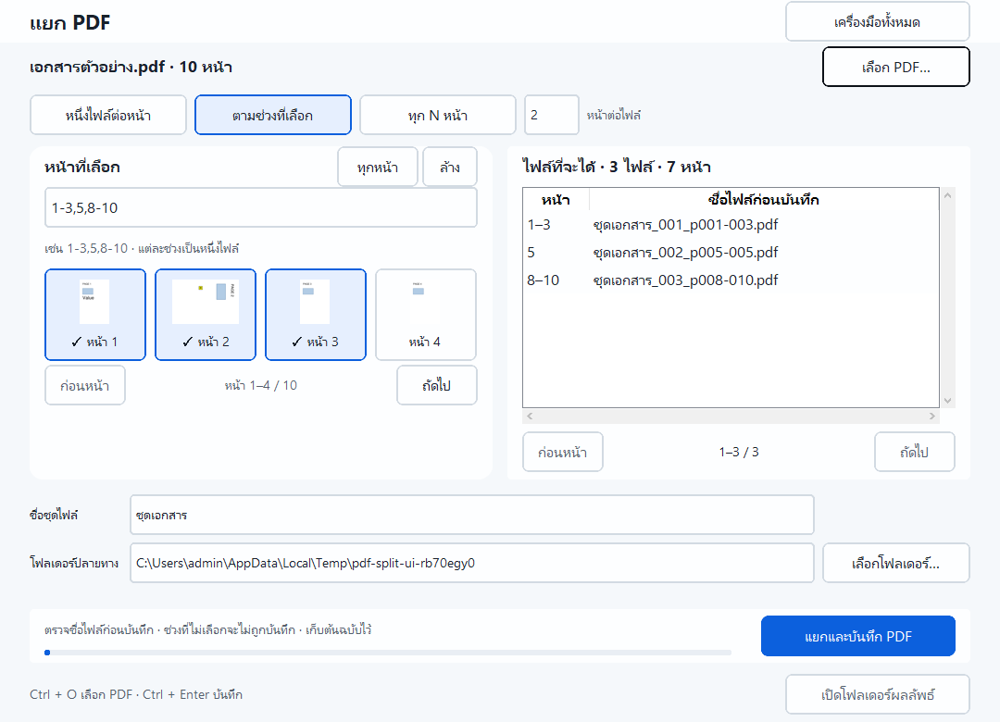

# แยก PDF · 1.3.0

เลือก **แยก PDF** จากหน้าแรก แล้วเลือก PDF หนึ่งไฟล์ หรือลากจาก Explorer
โปรแกรมอ่านจำนวนหน้าเบื้องหลังและเริ่มปลายทางที่ Documents ของผู้ใช้

| วิธีแยก | ผลลัพธ์ |
|---|---|
| หนึ่งไฟล์ต่อหน้า | ทุกหน้าเป็น PDF แยกไฟล์ตามลำดับเดิม |
| ตามช่วงที่เลือก | `1-3,5,8-10` ได้ 3 ไฟล์: หน้า 1–3, หน้า 5 และหน้า 8–10 |
| ทุก N หน้า | เช่น 10 หน้า แยกทุก 3 หน้า ได้ 3, 3, 3 และ 1 หน้า |

โหมดช่วงหน้าเลือกได้ด้วยภาพตัวอย่าง ปุ่มทุกหน้า/ล้าง หรือพิมพ์ช่วงเอง
คลิกภาพจะเลือกหรือยกเลิกหน้านั้น และรวมหน้าที่ติดกันเป็นช่วงในช่องข้อความ
ภาพหน้าเรียงเป็นหลายแถว ปรับ 1–4 คอลัมน์ตามพื้นที่ เลื่อนลงด้วยลูกล้อเมาส์หรือแถบเลื่อนด้านขวา
ใช้ลูกศร/Home/End/Page Up/Page Down เพื่อดูหน้า และ Space/Enter เพื่อเลือกหน้าที่โฟกัส
ต้องเรียงจากน้อยไปมาก; หน้าซ้ำ ช่วงทับกัน ช่วงย้อน และหน้าเกินเอกสารใช้ไม่ได้
ช่วงที่ไม่ได้เลือกจะไม่อยู่ในผลลัพธ์ ตัวเลข N ต้องเป็นจำนวนเต็มตั้งแต่ 1 ถึงจำนวนหน้า

ดู **ไฟล์ที่จะได้** เพื่อตรวจหน้า จำนวนไฟล์ และชื่อก่อนบันทึก
รายการแสดงทีละ 25 ไฟล์ เลื่อนดูชื่อยาวได้และใช้ปุ่มเปลี่ยนชุดรายการ
เปลี่ยนชื่อชุดไฟล์หรือโฟลเดอร์เพื่อแก้ชื่อซ้ำ ชื่อจริงเป็น
`ชุดเอกสาร_001_p001-003.pdf` โดยเลขลำดับและเลขหน้าเติมศูนย์เพื่อเรียงได้ถูกต้อง
จากนั้นกด **แยกและบันทึก PDF** และเปิดโฟลเดอร์ผลลัพธ์เมื่อเสร็จ

## การเก็บไฟล์เดิม

- ไม่แก้ต้นฉบับ ไม่ทับไฟล์เดิม และตรวจ alias ของต้นฉบับด้วย
- หากต้นฉบับเปลี่ยนหลัง preview ต้องเลือกไฟล์ใหม่
- ตรวจทุก PDF ชั่วคราวให้มีจำนวนหน้าถูกต้องก่อนสร้างผลลัพธ์จริง
- หากชื่อชนหรือเกิดปัญหาระหว่างบันทึก จะคืนไฟล์ที่งานนี้สร้างและยังไม่ถูกแก้โดยผู้อื่น
  หากคืนไม่ได้จะแสดงชื่อไฟล์ที่เหลือ ไม่รายงานว่างานสำเร็จครบ
- ตรวจรูปแบบชื่อ Windows; ข้อผิดพลาดพื้นที่ว่าง/สิทธิ์แสดงให้เลือกปลายทางใหม่

## ขอบเขต

รองรับ PDF ที่เปิดได้โดยไม่ต้องใส่รหัสผ่าน ทำครั้งละหนึ่งเอกสาร
เก็บเนื้อหาหน้า รูป ขนาด มุมหมุน annotations และฟอร์ม; ลิงก์ภายในเก็บเฉพาะ
ปลายทางที่อยู่ในไฟล์ผลลัพธ์เดียวกัน Bookmark เก็บเฉพาะหน้าที่อยู่ในช่วงนั้น
ไม่รับประกันการคง attachments, layers, document-level actions หรือ digital signatures
ยังไม่มีซูม preview ยกเลิกงาน หรือแก้ลำดับหน้าในเครื่องมือนี้

ตัวเลือกหน้าร่วมอยู่ใน `core/page_selection.py` และ `ui/page_selector.py`
ใช้ร่วมกับแยกหน้า ลบหน้า และหมุน PDF แล้ว; จัดระเบียบ PDF ยังอยู่ในแผน
หลักฐานการตรวจ: [split-verification.json](split-verification.json)

เลือกหลายหน้าได้ด้วย **Shift+คลิก**, **Ctrl+คลิก** และ **ลากครอบ**; ดู [วิธีเลือกหน้า](PAGE_SELECTION.md)

## หน้าจอ 1.6.0

เลือกโหมดที่เมนู **รูปแบบผลลัพธ์** ทางขวา: หนึ่งไฟล์ต่อหน้า / แบ่งตามช่วงหน้า / แบ่งทุก N หน้า; ช่อง N ปรากฏเฉพาะโหมดนั้น ตารางผลลัพธ์อยู่ใต้ settings และปุ่มบันทึกอยู่แถบล่างเสมอ ที่ 920×700 อาจต้องเลื่อน settings เมื่อเลือก N

[ภาพก่อน–หลังและขอบเขตการตรวจ](REDESIGN.md)

## นำทางรุ่น 1.7.0

หน้าแรกเป็นรายการงานเต็มความกว้าง กด **เปิด** ที่งานนั้น ทุกเครื่องมือมีเมนู **เปลี่ยนเครื่องมือ** บนแถบหัวหน้า และปุ่ม **หน้าแรก**; เอกสารและค่าของแต่ละงานยังอยู่เมื่อสลับเครื่องมือ เมื่องานกำลังทำอยู่ ระบบล็อกการสลับจนเสร็จ
