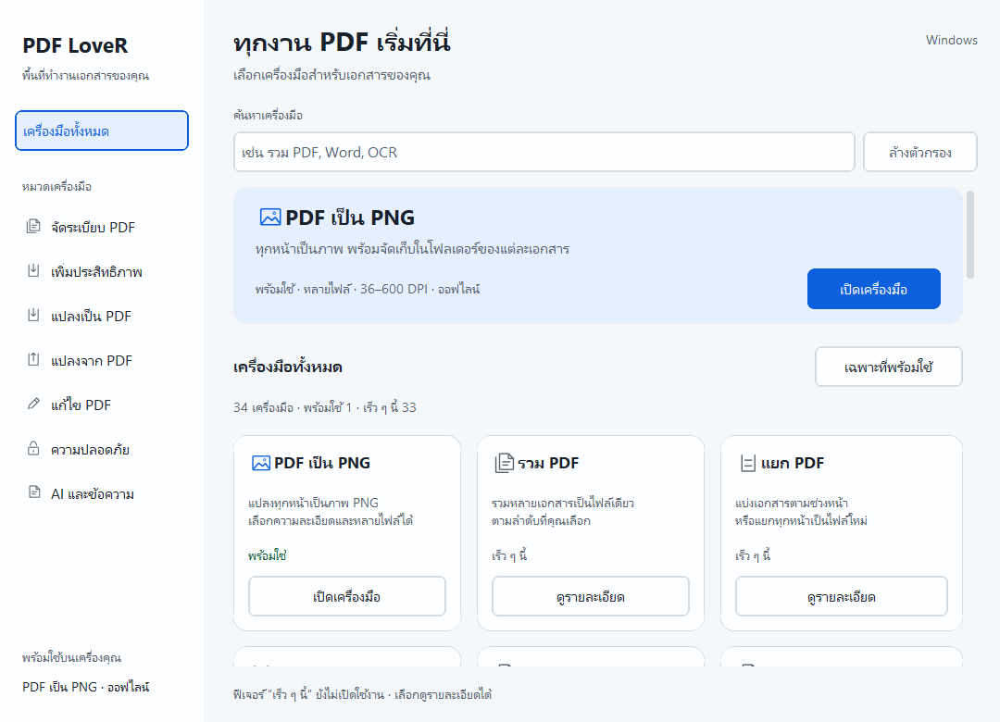

# PDF LoveR — หน้าแรกสำหรับชุดเครื่องมือ PDF

หน้าแรกของโปรแกรมเป็นศูนย์รวมเครื่องมือ เลือกหมวด ค้นหาชื่อไทยหรืออังกฤษ
และกรองเฉพาะเครื่องมือที่พร้อมใช้งานได้

## สถานะปัจจุบัน

- **พร้อมใช้ 9/34 รุ่น 1.14.0:** PDF to Image, รวม, แยก, แยกหน้า, ลบหน้า, หมุน, จัดหน้า, หมายเลขหน้า และ [ใส่ลายน้ำ](WATERMARK.md) — ใช้งานออฟไลน์
- **เร็ว ๆ นี้:** เครื่องมืออื่นในแผนพัฒนา เปิดอ่านรายละเอียดได้ ยังประมวลผลไฟล์ไม่ได้
- ไม่มีการอัปโหลดเอกสารหรือเชื่อมระบบ AI ในหน้าแรกนี้
- ลาก PDF มาวางในหน้าแรกเพื่อเปิดเครื่องมือรวมไฟล์ หรือวางในเครื่องมือที่เปิดอยู่เพื่อเพิ่มไฟล์
- ปลายทางเริ่มต้นของทุกเครื่องมือที่พร้อมใช้คือ Documents ของผู้ใช้
- ชุดแจกที่ส่งมอบแล้วล่าสุด 1.14.0 มี EXE, ตัวติดตั้ง และ ZIP
- ลิงก์ชุดแจกล่าสุดดู [README](../README.md); อีก 25 เครื่องมือยังอยู่ในแผน

## หมวดเครื่องมือ

| หมวด | เครื่องมือ |
| --- | --- |
| จัดระเบียบ PDF | รวม, แยก, ลบหน้า, แยกหน้า, จัดระเบียบ, สแกน |
| เพิ่มประสิทธิภาพ | บีบอัด, ซ่อม, OCR |
| แปลงเป็น PDF | JPG, Word, PowerPoint, Excel, HTML |
| แปลงจาก PDF | PNG, JPG, Word, PowerPoint, Excel, PDF/A |
| แก้ไข PDF | หมุน, หมายเลขหน้า, ลายน้ำ, ครอบตัด, แก้ไข, แบบฟอร์ม |
| ความปลอดภัย | ปลดล็อก, ป้องกัน, เซ็น, ปิดบังข้อความ, เปรียบเทียบ |
| AI และข้อความ | สรุป, แปล, Markdown |

รายการซ้ำใน brief รวมเป็นเครื่องมือเดียว ยังไม่กำหนดวันเปิดใช้ฟีเจอร์ใหม่
ดูงานที่เหลือ ลำดับพัฒนา และเกณฑ์เสร็จของแต่ละเครื่องมือใน [Task list](../TASKS.md)
งาน Office, OCR, AI, PDF/A และลายเซ็นต้องมีระบบประมวลผลเพิ่มเติมและการทดสอบเฉพาะด้าน
คุณภาพการแปลงขึ้นอยู่กับเอกสาร จึงยังไม่มีคำรับประกันความแม่นยำเป็นเปอร์เซ็นต์

## การใช้งาน

1. เลือก **PDF เป็น PNG → เปิดเครื่องมือ**
2. เพิ่มเอกสาร ตั้งค่าปลายทางและ DPI แล้วเริ่มแปลง
3. กด **เครื่องมือทั้งหมด** เพื่อกลับ โดยรายการไฟล์และการตั้งค่ายังอยู่

**Ctrl + F** กลับหน้าแรกและค้นหา · **Ctrl + O** เปิดตัวแปลงแล้วเลือก PDF
หรือเพิ่มไฟล์ในหน้ารวม · **Alt + ←** กลับหน้าแรก · **Ctrl + Enter** เริ่มงานในเครื่องมือที่เปิดอยู่

ระหว่างแปลง ปุ่มกลับหน้าแรกจะปิดชั่วคราวเพื่อให้สถานะงานอยู่ในหน้าที่มองเห็น

## เพิ่มเครื่องมือในอนาคต

`pdf_lover/catalog.py` เก็บหมวด คำอธิบาย คำค้น และสถานะไว้ที่เดียว
`pdf_lover/ui/home.py` แสดงรายการและรายละเอียดเครื่องมือที่อยู่ในแผน
`pdf_lover/app.py` ดูแล navigation และเรียกหน้าที่ลงทะเบียนไว้
`pdf_lover/features/` แยกแต่ละเครื่องมือเป็นหน้าจอและระบบประมวลผล

ก่อนตั้ง `ready=True` ให้สร้างหน้าที่ทำงานจริงและลงทะเบียนใน `features/registry.py`
แล้วทดสอบผลลัพธ์ก่อนเปิดให้ผู้ใช้ใช้งาน ดูขั้นตอนใน [Contributing](../CONTRIBUTING.md)

ตรวจหน้าแรกและการกลับไปทำงานด้วย `python tests/ui/verify_home.py`
การติดตั้ง dependencies และรันซอร์สดูได้ใน [Development](DEVELOPMENT.md)
